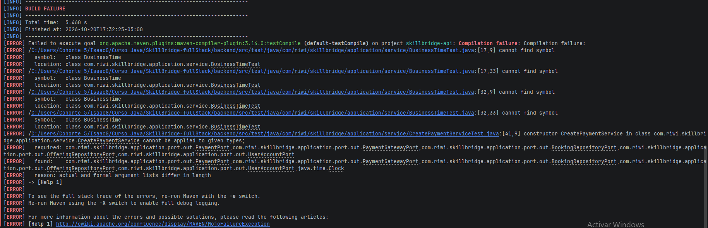
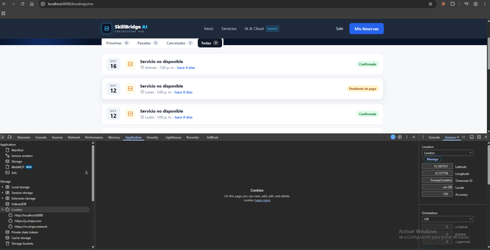

# BUG-04 · El pago se registra con la fecha del día siguiente

> **Jira:** SCRUM-325 (épica SCRUM-149 · Experiencia del cliente) · **Sprint:** 3 · **Rama:** `BUG-04`
> **Bloquea a:** HU-37 y HU-38, que reutilizan la zona horaria configurable de este bug.

Como **cliente** quiero que mi pago quede registrado con la fecha en que lo hice, para que mis comprobantes y el historial sean correctos.

---

## 1. Reporte

**Pasos para reproducir**
1. Después de las 7:00 p. m. (hora de Colombia), reservar una mentoría y pagarla con la tarjeta de prueba de Stripe `4242 4242 4242 4242`.
2. Revisar la fecha registrada del pago (`payments.created_at`).

**Esperado:** la fecha del día en que se pagó, en hora de Colombia.
**Observado:** el pago queda con la fecha del día siguiente.

## 2. Causa raíz

Colombia es UTC-5 y el servidor (Render) corre en UTC: todo lo que ocurre después de las 19:00 de Bogotá ya es el día siguiente en UTC. Guardar el instante en UTC (`TIMESTAMPTZ`, `hibernate.jdbc.time_zone: UTC`) es correcto; el error estaba en **quién decide la hora** y **en qué zona se interpreta**:

1. **La fecha del pago la ponía la base de datos, no el servicio.** `PaymentPersistenceAdapter.save()` no copiaba `createdAt` del dominio y `PaymentEntity` lo sobrescribía con `Instant.now()` en `@PrePersist`.
2. **No existía una zona horaria de negocio central.** `America/Bogota` estaba escrita a mano en varios servicios y la hora salía de `Instant.now()` / `ZonedDateTime.now()`, imposibles de controlar en un test.
3. **El frontend formateaba las fechas con la zona del navegador** (`Intl.DateTimeFormat` sin `timeZone`): quien abría la página fuera de Colombia veía otra hora u otro día.

## 3. Solución

| Capa | Cambio |
|---|---|
| Configuración | `app.timezone: ${APP_TIMEZONE:America/Bogota}` en `application.yml`: la zona de negocio vive en un solo lugar |
| Backend | `BusinessTime` (`Clock` + `ZoneId`) con `now()`, `today()`, `toLocalDate()` y `startOfMonth()`; se crea en `TimeConfiguration` con `Clock.systemUTC()` |
| Pagos | `CreatePaymentService` fecha el pago con el `Clock` inyectado; `PaymentPersistenceAdapter` guarda esa fecha y `@PrePersist` solo la pone si falta |
| Admin | La métrica "este mes" usa `businessTime.startOfMonth()` (medianoche del día 1 en Bogotá) |
| Notificaciones | El texto ("jueves 10 de octubre a las 10:00") y `createdAt` usan `BusinessTime` |
| Frontend | `shared/business-time.ts`: `businessDateFormat()` fija `timeZone: 'America/Bogota'` en todos los formatos de fecha y `businessDayKey()` agrupa los horarios por día en hora de Colombia |

Los datos ya guardados **no se modificaron**: el instante en UTC era correcto, solo cambia cómo se interpreta. No hace falta migración Flyway.

## 4. Evidencia

### 4.1 Test que demuestra el fallo antes de corregirlo

El test se escribió primero (commit `4352b6d`) y falló: no compilaba porque no existía forma de inyectar el reloj ni la zona de negocio, que es justamente la causa raíz.

### 4.2 Pruebas automatizadas que cubren la regresión

| Prueba | Qué demuestra |
|---|---|
| `BusinessTimeTest` | Un pago a las 23:30 de Bogotá (04:30 UTC) pertenece al mismo día; el inicio de mes usa la medianoche de Bogotá |
| `CreatePaymentServiceTest.shouldStampPaymentWithInjectedClock` | El pago se fecha con el reloj inyectado |
| `PaymentCreatedAtTest` (Testcontainers) | La fecha decidida por el servicio llega intacta a PostgreSQL |
| `AdminUserServiceTest` | La métrica mensual usa el reloj y la zona inyectados |
| `RecordBookingNotificationServiceTest.notificationUsesInjectedClock` | La notificación se fecha con el reloj inyectado; los mensajes existentes siguen en hora de Colombia |
| `business-time.spec.ts` | El frontend muestra 23:30 y el día 19 aunque el navegador esté en otra zona |

### 4.3 Prueba manual

Con el navegador en **Europe/London** (DevTools → Sensors → Location), *Mis reservas* sigue mostrando las horas de Colombia (por ejemplo, viernes 16 de octubre a las 7:30 p. m.), no las de Londres.

## 5. Casos revisados con el mismo patrón

| Sitio | Decisión |
|---|---|
| `ProviderOfferingService` | Ya usaba `America/Bogota` correctamente, escrita a mano. Pendiente migrarla a `BusinessTime` (HU-37) |
| `Instant.now()` en reservas, catálogo, eventos y adaptadores de persistencia | Solo comparan o sellan instantes en UTC; no muestran fechas ni agrupan por día. No causan el bug |
| `provider-slots.component.ts` (frontend) | Interpreta la fecha y hora que escribe el proveedor en la zona del navegador. Hoy todos los proveedores están en Colombia; si eso cambia, migrar con una librería de zonas (por ejemplo `date-fns-tz`) |

## 6. Para las siguientes historias

HU-37 y HU-38 deben inyectar `BusinessTime` en lugar de usar `Instant.now()` o `ZoneId.of(...)`. En los tests, construirlo con `new BusinessTime(Clock.fixed(...), ZoneId.of("America/Bogota"))`.
