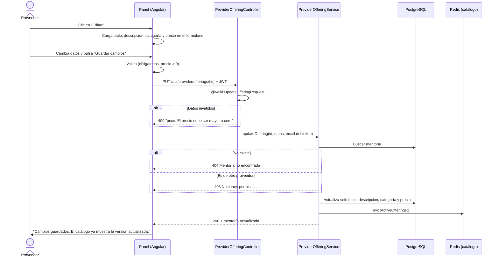
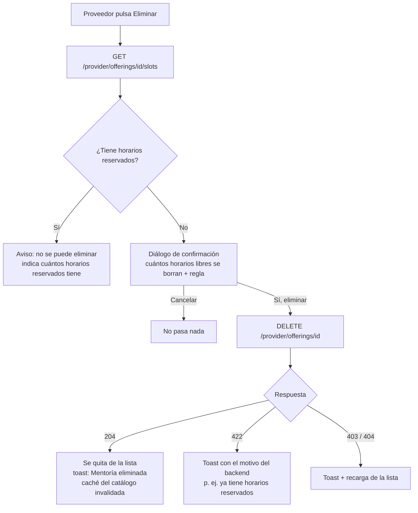

# HU-19 · Editar y eliminar mis mentorías

> **Jira:** SCRUM-164 (épica SCRUM-150) · **Rama:** `HU-19-Editar-y-eliminar-mis-mentorias`
> **Rol:** Proveedor · Primera historia de la pista del proveedor. HU-20, HU-21 y HU-22 trabajan sobre el mismo formulario y deben hacerse después.

Como **proveedor**, quiero **editar y eliminar mis mentorías** para mantener mi catálogo al día sin depender de un administrador.

---

## 1. Criterios de aceptación

| # | Criterio | Cómo se cumple |
|---|----------|----------------|
| 1 | Existe `PUT /api/provider/offerings/{id}` que solo permite editar mentorías propias (403/404 en otro caso) | Nuevo endpoint en `ProviderOfferingController`. El servicio verifica que el proveedor del token sea el dueño: **403** si la mentoría es de otro proveedor y **404** si no existe. |
| 2 | El panel del proveedor permite editar título, descripción, categoría y precio de cada mentoría | Botón **Editar** en cada mentoría. Carga los datos en el formulario, que cambia a modo edición con **Guardar cambios** y **Cancelar edición**. |
| 3 | Eliminar pide confirmación y explica que no se puede eliminar una mentoría con horarios reservados | Antes de borrar se consultan los horarios. Si hay reservados, se explica por qué no se puede eliminar y no se muestra el diálogo. Si no los hay, aparece un diálogo de confirmación que recuerda la regla. |
| 4 | Los cambios se reflejan en el catálogo (se invalida la caché) | Editar y eliminar llaman a `OfferingCachePort.evictActiveOfferings()` y borran la clave `offerings:active` de Redis. |
| 5 | Validaciones de backend: campos obligatorios y precio mayor a cero | Bean Validation en `UpdateOfferingRequest` (**400**) y una segunda validación en el servicio (**422**). |

---

## 2. Subtareas y commits

| Subtarea | Descripción | Commit |
|----------|-------------|--------|
| **SCRUM-165** | [Backend] Endpoint `PUT /api/provider/offerings/{id}` | `feat(SCRUM-165): endpoint PUT /api/provider/offerings/{id} para editar mentorias propias` |
| **SCRUM-166** | [Frontend] Edición de mentorías en el panel del proveedor | `feat(SCRUM-166): edicion de mentorias en el panel del proveedor` |
| **SCRUM-167** | [Frontend] Confirmación y mensajes al eliminar | `feat(SCRUM-167): confirmacion y mensajes claros al eliminar mentorias` |
| **SCRUM-168** | [QA] Pruebas de edición y propiedad | `test(SCRUM-168): pruebas de edicion, propiedad y eliminacion de mentorias` |

---

## 3. Flujo de negocio

### 3.1 Editar una mentoría



**Reglas:**
- Solo se editan **título, descripción, categoría y precio**. El dueño (`providerId`), el estado (`active`) y la fecha de creación (`created_at`) se conservan.
- Los textos se guardan sin espacios sobrantes al inicio y al final.
- El precio de una mentoría editada aplica a las **reservas nuevas**. Las reservas ya hechas no se modifican.

### 3.2 Eliminar una mentoría



**Reglas:**
- Una mentoría con **al menos un horario reservado** no se puede eliminar (regla del backend → **422**).
- Al eliminarla se borran primero sus horarios **libres** y después la mentoría.
- La revisión previa del frontend es solo para avisar a tiempo. Quien decide es el backend: si un cliente reserva entre la revisión y el clic, el backend responde 422 y el panel muestra el motivo.

---

## 4. Backend

### 4.1 Contrato del endpoint

`PUT /api/provider/offerings/{id}` · Rol: `PROVIDER` · Autenticación: `Authorization: Bearer <jwt>`

**Request**
```json
{
  "title": "Spring Boot avanzado",
  "description": "Seguridad, JPA y buenas prácticas",
  "category": "BACKEND",
  "price": 120000
}
```

| Campo | Regla |
|-------|-------|
| `title` | Obligatorio, no vacío, máx. 160 caracteres |
| `description` | Obligatorio, no vacío, máx. 1200 caracteres |
| `category` | Obligatorio, no vacío, máx. 80 caracteres |
| `price` | Obligatorio, mayor a cero |

Los máximos coinciden con las columnas de la tabla `offerings` (`V1__init.sql`).

**Respuestas**

| Código | Cuándo | Cuerpo |
|--------|--------|--------|
| `200 OK` | Edición exitosa | La mentoría actualizada (`id`, `providerId`, `title`, `description`, `category`, `price`, `active`) |
| `400 Bad Request` | Falla una validación | `ProblemDetail` con `detail`, p. ej. `"price: El precio debe ser mayor a cero"` |
| `401 Unauthorized` | Sin token o token inválido | `ProblemDetail` |
| `403 Forbidden` | La mentoría es de otro proveedor, o el usuario no es `PROVIDER` | `ProblemDetail` |
| `404 Not Found` | La mentoría no existe | `ProblemDetail` |

`DELETE /api/provider/offerings/{id}` ya existía. Con esta HU, cuando la mentoría es de otro proveedor responde **403** en lugar de 422.

### 4.2 Archivos modificados

| Archivo | Cambio |
|---------|--------|
| `infrastructure/adapter/in/rest/dto/UpdateOfferingRequest.java` | **Nuevo.** DTO con Bean Validation (`@NotBlank`, `@Size`, `@NotNull`, `@DecimalMin(0, exclusivo)`). |
| `infrastructure/adapter/in/rest/ProviderOfferingController.java` | Nuevo `@PutMapping("/{id}")` con `@Valid`. |
| `application/service/ProviderOfferingService.java` | Nuevo `updateOffering(...)`: verifica el dueño, valida, actualiza e invalida la caché. `getOwnedOffering` lanza `UnauthorizedActionException` (403) en lugar de `BusinessRuleException` (422). |
| `application/port/out/OfferingRepositoryPort.java` | Nuevo método `update(Offering)`. |
| `infrastructure/adapter/out/persistence/OfferingPersistenceAdapter.java` | Implementa `update`: carga la entidad existente y cambia solo los campos editables. |
| `infrastructure/adapter/out/persistence/entity/OfferingEntity.java` | Nuevo `updateDetails(...)`. |

### 4.3 Decisiones técnicas

- **¿Por qué `update` y no `save`?** El constructor de `OfferingEntity` asigna `createdAt = Instant.now()`. Si se guardara una entidad nueva con el mismo id, se reiniciaría la fecha de creación. `update` modifica la entidad que ya existe.
- **Dos barreras de validación.** Bean Validation responde 400 en la capa HTTP. El servicio vuelve a validar (422) por si otro caso de uso lo llama sin pasar por el controlador.
- **403 vs 404.** Si la mentoría no existe → 404. Si existe pero es de otro proveedor → 403, como pide el criterio de aceptación. El cambio a `UnauthorizedActionException` aplica a todas las operaciones del proveedor: editar, eliminar y gestionar horarios.
- **Arquitectura hexagonal.** El controlador solo traduce HTTP. La regla de propiedad vive en el servicio, y la persistencia queda detrás de `OfferingRepositoryPort`.

---

## 5. Frontend

### 5.1 Archivos modificados

| Archivo | Cambio |
|---------|--------|
| `core/offering.service.ts` | Interfaz `OfferingInput` y método `updateProviderOffering(id, data)` → `PUT`. |
| `features/provider-offerings.component.ts` | Modo edición del formulario (SCRUM-166) y flujo de eliminación con confirmación (SCRUM-167). |
| `features/provider-offerings.component.spec.ts` | **Nuevo.** Pruebas del componente (SCRUM-168). |

### 5.2 Edición (SCRUM-166)

- Cada mentoría de la lista tiene un botón **Editar**. Al pulsarlo:
  - el formulario se llena con sus datos y cambia el título a **Editar Mentoría**, con la etiqueta *Editando*;
  - la mentoría queda resaltada en la lista;
  - aparecen los botones **Guardar cambios** y **Cancelar edición**.
- **Validaciones del formulario:** campos obligatorios, sin textos que sean solo espacios, precio mayor a cero y los mismos máximos que el backend. Cada campo muestra su error debajo.
- **Al guardar** se reemplaza la mentoría en la lista con la respuesta del backend, sin volver a consultar todo.
- **Mensajes según la respuesta:**
  - **400:** "Revisa los datos: …" con el detalle que envía el backend.
  - **403:** "No puedes editar una mentoría que pertenece a otro proveedor."
  - **404:** "La mentoría ya no existe. Actualizamos tu lista."
  - Con 403 y 404 se sale del modo edición y se recarga la lista.

### 5.3 Eliminación (SCRUM-167)

- Reemplaza el `window.confirm` del navegador por el diálogo propio de la app (`AlertService.confirm`, en rojo por ser una acción destructiva) y por toasts.
- Debajo del título de la lista se muestra el aviso: *"Solo puedes eliminar mentorías sin horarios reservados."*
- Antes de pedir confirmación se consultan los horarios de la mentoría:
  - **Con horarios reservados:** toast de error con la cantidad de horarios reservados. No se abre el diálogo.
  - **Sin horarios reservados:** diálogo *¿Eliminar "X"?*, que indica cuántos horarios libres se borrarán y recuerda la regla.
- Mientras se elimina, el botón muestra **Eliminando...** y queda deshabilitado, para evitar dobles clics.
- **Errores del backend:** 422 → muestra el motivo. 403 → "Esta mentoría pertenece a otro proveedor". 404 → "La mentoría ya no existe" y recarga la lista.
- Si se elimina la mentoría que se estaba editando, el formulario sale del modo edición.

---

## 6. Pruebas (SCRUM-168)

### Backend

| Clase | Qué cubre |
|-------|-----------|
| `ProviderOfferingUpdateServiceTest` | Edición exitosa: conserva dueño y estado, recorta espacios e invalida la caché. Otro proveedor → `UnauthorizedActionException` sin guardar ni invalidar la caché. Mentoría inexistente → `DomainNotFoundException`. Precio 0, negativo o nulo y campos vacíos → `BusinessRuleException`. Eliminar una mentoría ajena → 403. |
| `ProviderOfferingControllerTest` (`@WebMvcTest`) | `PUT`: 200, 400 (precio 0, título vacío, precio ausente), 403 (otro proveedor y rol `CUSTOMER`), 404 y 401 sin token. `DELETE`: 204, 422 con explicación y 403. |
| `ProviderOfferingServiceTest` | Ajustado: una mentoría de otro proveedor ahora lanza `UnauthorizedActionException`. |

```bash
cd backend
mvn test -Dtest='ProviderOffering*'   # solo las pruebas de esta HU
mvn clean verify                      # todo, igual que el CI (requiere Docker para Testcontainers)
```

### Frontend

`provider-offerings.component.spec.ts`, con 10 pruebas:
- **Edición:**
  - carga de datos en el formulario;
  - `PUT` con datos limpios y lista actualizada;
  - bloqueo con precio 0 o con campos que solo tienen espacios;
  - manejo del 403;
  - cancelar la edición.
- **Eliminación:**
  - sin diálogo si hay horarios reservados;
  - confirmación con la cantidad de horarios libres;
  - cancelar no elimina;
  - eliminación exitosa;
  - manejo del 422.

```bash
cd frontend
npm test -- --watch=false --include='src/app/features/provider-offerings.component.spec.ts'
```

### Prueba manual sugerida

1. Inicia sesión como proveedor y entra a **/provider/offerings**.
2. **Edita una mentoría.** Cambia el precio y pulsa **Guardar cambios**. Luego abre **/servicios** y verifica que el catálogo ya muestra el nuevo precio.
3. **Intenta guardar con precio 0.** El botón queda deshabilitado y el campo muestra el error.
4. **Elimina una mentoría sin reservas.** Debe aparecer el diálogo de confirmación; al aceptar, desaparece de la lista y del catálogo.
5. **Intenta eliminar una mentoría con un horario reservado** (resérvalo antes con un cliente). Aparece el aviso y no se abre el diálogo.
6. **Comprueba el 403** con Postman o curl: usa el token de **otro** proveedor y haz `PUT /api/provider/offerings/{id}`. Debe responder **403**.

---

## 7. Notas y pendientes

- **`POST /api/provider/offerings` (crear) todavía no usa Bean Validation.** Solo valida el formulario del frontend. Se puede reutilizar `UpdateOfferingRequest` en una HU siguiente (HU-20 a HU-22 trabajan sobre el mismo formulario).
- **La revisión previa de horarios usa `GET /provider/offerings/{id}/slots`, que solo devuelve horarios futuros.** Si una mentoría tiene un horario reservado en el pasado, el backend igual bloquea la eliminación (422) y el panel muestra el motivo.
