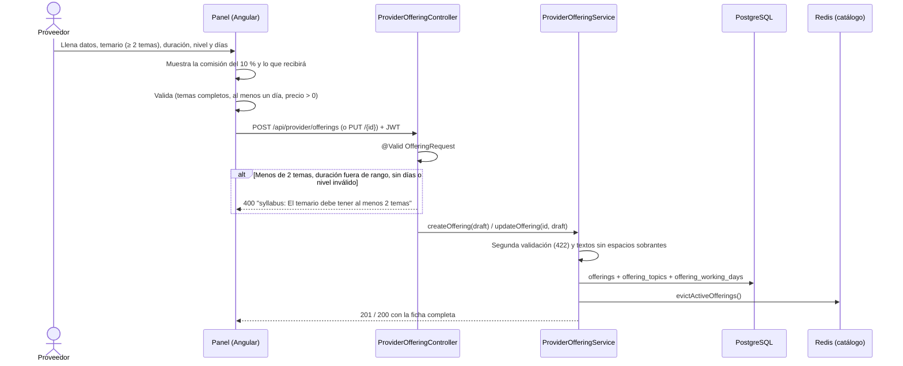
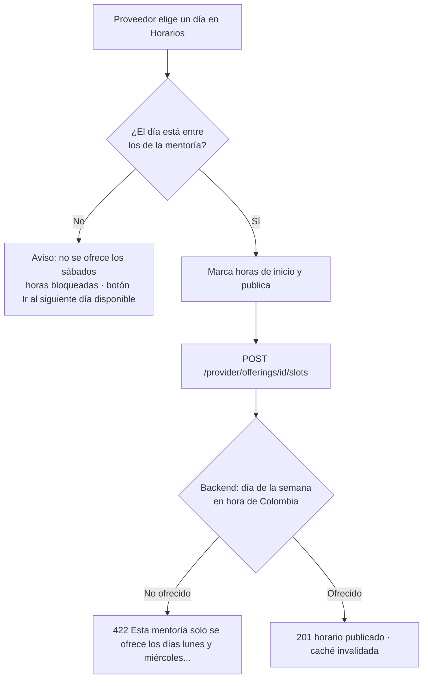

# HU-20 · Ficha completa de la mentoría

> **Jira:** HU-20 (épica SCRUM-150 · Panel del proveedor) · **Sprint:** 2 · **Rama:** `HU-20`
> **Depende de:** HU-19 (mismo formulario y entidad).

Como **proveedor** quiero describir mi mentoría con su **temario, duración, nivel y días en que la ofrezco**, para que el cliente sepa exactamente qué va a recibir.

---

## 1. Criterios de aceptación

| # | Criterio | Cómo se cumple |
|---|----------|----------------|
| 1 | La mentoría guarda un temario definido por el proveedor con mínimo 2 temas (título y descripción breve); con menos el backend responde 400 | Tabla `offering_topics`. `OfferingRequest` exige `@Size(min = 2)` → **400** `"syllabus: El temario debe tener al menos 2 temas"`. El servicio repite la regla como segunda barrera (422). |
| 2 | El temario reemplaza el contenido fijo que mostraba el detalle de servicio (`service-content.ts`) | El detalle pinta `offering.syllabus`. A `service-content.ts` solo le queda el ícono por categoría. El temario fijo de las 3 mentorías de ejemplo se movió a la base de datos con la migración V8. |
| 3 | La mentoría guarda su duración; el horario muestra hora de inicio y de finalización | Columna `duration_minutes` (30–240). El detalle, la reserva y el panel de horarios muestran `9:00 a. m. – 10:30 a. m.` (inicio + duración). |
| 4 | El proveedor indica los días de la semana en que ofrece la mentoría; al publicar horarios solo puede elegir esos días | Tabla `offering_working_days`. El backend rechaza con **422** un horario que cae en otro día (calculado en hora de Colombia). El panel de horarios avisa, bloquea las horas y ofrece saltar al siguiente día disponible. |
| 5 | La mentoría guarda el nivel (básico, intermedio, avanzado) | Columna `level` con los valores `BASICO`, `INTERMEDIO` y `AVANZADO`. |
| 6 | El formulario muestra un aviso visible: la plataforma cobra una comisión del 10 % sobre el valor de cada mentoría, con el valor que recibirá el proveedor | Recuadro bajo el precio, que se recalcula al escribir: *"Por cada sesión de $ 85.000 recibirás $ 76.500 (comisión: $ 8.500)"*. |
| 7 | Migración Flyway nueva; las mentorías existentes quedan con valores por defecto válidos | `V8__offering_profile.sql`. Las mentorías existentes quedan con 60 min, nivel básico, todos los días y al menos 2 temas. |

---

## 2. Subtareas y commits

| Subtarea | Descripción | Commit |
|----------|-------------|--------|
| **SCRUM-170** | [Backend] Migración y entidad: temario, duración, nivel y días laborales | `feat(SCRUM-170): migracion y entidad de la ficha de mentoria (temario, duracion, nivel y dias)` |
| **SCRUM-171** | [Backend] Validaciones de la ficha (mínimo 2 temas, duración y días) | `feat(SCRUM-171): validaciones de la ficha de mentoria` |
| **SCRUM-172** | [Backend] Restringir horarios a los días laborales | `feat(SCRUM-172): restringir horarios a los dias que ofrece la mentoria` |
| **SCRUM-173** | [Frontend] Formulario de mentoría con temario dinámico y aviso de comisión | `feat(SCRUM-173): formulario de la ficha con temario dinamico y aviso de comision` |
| **SCRUM-174** | [Frontend] Detalle de servicio con temario real y hora de finalización | `feat(SCRUM-174): detalle del servicio con temario real y hora de finalizacion` |
| **SCRUM-175** | [QA] Pruebas de la ficha completa | `test(SCRUM-175): pruebas de la ficha completa de la mentoria` |
| **SCRUM-176** | [Docs] Documentar el nuevo contrato de mentoría | `docs(SCRUM-176): documentar el contrato de la ficha de mentoria` |

---

## 3. Flujo de negocio

### 3.1 El proveedor publica o edita la ficha



### 3.2 El proveedor publica horarios



### 3.3 El cliente ve el detalle y reserva

1. `GET /api/offerings/{id}` devuelve la mentoría con su ficha.
2. El detalle muestra:
   - **duración**, **nivel** y **días** como etiquetas en la cabecera;
   - el **temario real** en el orden que definió el proveedor;
   - **Próximos horarios**: hasta 6, con hora de inicio y de finalización.
3. En la reserva, cada hora muestra su rango (`10:00 a. m. – 11:00 a. m.`) y el resumen dice *"el lunes, 19 de octubre de 10:00 a. m. a 11:00 a. m."*.

**Reglas de negocio:**
- **Temario:** de 2 a 12 temas. Cada tema necesita título (máx. 120) y descripción breve (máx. 300). Se guardan en el orden enviado.
- **Duración:** de 30 a 240 minutos. El formulario ofrece 30, 45, 60, 90, 120, 180 y 240.
- **Nivel:** `BASICO`, `INTERMEDIO` o `AVANZADO`.
- **Días:** al menos uno.
  - Un horario solo se puede publicar en uno de esos días.
  - El día se calcula en hora de Colombia (`America/Bogota`). Por eso un domingo a las 23:30 cuenta como domingo, aunque en UTC ya sea lunes.
  - Los horarios que ya estaban publicados no se borran si el proveedor quita un día: la regla aplica a los horarios nuevos.
- **Comisión:** la plataforma cobra el **10 %** del valor de cada mentoría, y el proveedor recibe el **90 %**. Por ahora es informativa: se muestra en el formulario y no cambia los pagos.

---

## 4. Backend

### 4.1 Contrato

`POST /api/provider/offerings` (201) y `PUT /api/provider/offerings/{id}` (200) · Rol `PROVIDER`

```json
{
  "title": "Kubernetes desde cero",
  "description": "Primeros pasos con pods y despliegues",
  "category": "CLOUD",
  "price": 90000,
  "syllabus": [
    { "title": "Pods", "description": "Qué son y cómo se crean" },
    { "title": "Deployments", "description": "Réplicas y actualizaciones" }
  ],
  "durationMinutes": 90,
  "level": "INTERMEDIO",
  "workingDays": ["MONDAY", "WEDNESDAY"]
}
```

La respuesta y todos los `GET` (`/api/offerings`, `/api/offerings/{id}`, `/api/provider/offerings`) devuelven la mentoría con estos mismos campos, más `id`, `providerId` y `active`. Los días siempre salen ordenados de lunes a domingo.

| Código | Cuándo | `detail` de ejemplo |
|--------|--------|---------------------|
| `400` | Menos de 2 temas | `syllabus: El temario debe tener al menos 2 temas` |
| `400` | Más de 12 temas | `syllabus: El temario admite máximo 12 temas` |
| `400` | Tema sin título | `syllabus[1].title: Cada tema necesita un título` |
| `400` | Duración fuera de rango | `durationMinutes: La duración mínima es de 30 minutos` |
| `400` | Sin días | `workingDays: Elige al menos un día de la semana` |
| `400` | Valor que no existe | `level: valor no permitido 'EXPERTO'. Usa uno de: BASICO, INTERMEDIO, AVANZADO` |
| `403` / `404` | Mentoría de otro proveedor / inexistente | (igual que en HU-19) |
| `422` | Horario en un día no ofrecido (`POST …/slots`) | `Esta mentoría solo se ofrece los días lunes y miércoles. El sábado no está entre ellos` |

### 4.2 Migración `V8__offering_profile.sql`

```text
offerings              + duration_minutes INTEGER NOT NULL DEFAULT 60   (CHECK 30..240)
                       + level VARCHAR(20) NOT NULL DEFAULT 'BASICO'    (CHECK BASICO|INTERMEDIO|AVANZADO)
offering_topics        (offering_id, position, title, description)      PK (offering_id, position) · ON DELETE CASCADE
offering_working_days  (offering_id, day_of_week)                       PK (offering_id, day_of_week) · ON DELETE CASCADE
```

**Datos existentes:**
- **Todas las mentorías:** quedan con 60 minutos, nivel básico y **todos los días**. Así ningún proveedor pierde días en los que ya podía publicar.
- **Las 3 mentorías de ejemplo (V1):** reciben su nivel real y 4 temas cada una, tomados del contenido que antes estaba fijo en `service-content.ts`.
- **Las demás:** reciben un temario genérico de 2 temas ("Diagnóstico y objetivos" y "Práctica guiada"), que el proveedor puede editar.

### 4.3 Archivos

| Capa | Archivo | Cambio |
|------|---------|--------|
| Dominio | `domain/model/Offering.java` | Nuevos campos `syllabus`, `durationMinutes`, `level` y `workingDays`, con valores por defecto válidos. Método `offersOn(DayOfWeek)`. Se mantiene el constructor de 7 argumentos. |
| Dominio | `domain/model/SyllabusTopic.java`, `OfferingLevel.java` | **Nuevos.** |
| Aplicación | `application/port/in/OfferingDraft.java` | **Nuevo.** Datos de crear/editar y límites compartidos (2–12 temas, 30–240 min). |
| Aplicación | `application/service/ProviderOfferingService.java` | `createOffering(draft)` y `updateOffering(id, draft)` con validación. `addAvailabilitySlot` rechaza los días no ofrecidos. |
| Infraestructura | `adapter/in/rest/dto/OfferingRequest.java` | **Nuevo.** Cuerpo de POST y PUT con Bean Validation. Reemplaza a `UpdateOfferingRequest` y al record local de creación. |
| Infraestructura | `adapter/in/rest/ProviderOfferingController.java` | POST ahora también valida (`@Valid`). |
| Infraestructura | `adapter/in/rest/GlobalExceptionHandler.java` | `HttpMessageNotReadableException` → 400, con el campo y los valores permitidos. |
| Infraestructura | `persistence/entity/OfferingEntity.java`, `SyllabusTopicEmbeddable.java`, `OfferingPersistenceAdapter.java` | Colecciones `@ElementCollection` (temario ordenado con `@OrderColumn` y días) y `update` que reemplaza la ficha. |
| Recursos | `db/migration/V8__offering_profile.sql` | **Nueva** migración. |

### 4.4 Decisiones técnicas

- **`@ElementCollection` con `EAGER`:** la mentoría también se lee fuera de una petición HTTP (consumidores de RabbitMQ) y `open-in-view` está apagado. Con carga diferida habría `LazyInitializationException`. El temario es una lista indexada (`@OrderColumn`), no una *bag*, así que Hibernate puede cargar las dos colecciones sin `MultipleBagFetchException`.
- **Constructor de 7 argumentos en `Offering`:** se conserva con valores por defecto (sin temario, 60 min, básico, todos los días). Así el código y las pruebas que solo usan los datos básicos siguen funcionando sin cambios.
- **Valores por defecto en el *record*:** si llega una mentoría sin ficha (por ejemplo, un JSON viejo de la caché de Redis), se normaliza a valores válidos en lugar de fallar.
- **Zona horaria:** el día de un horario se decide en `America/Bogota`, la misma zona que usa el resto del backend (métricas y notificaciones).

---

## 5. Frontend

| Archivo | Cambio |
|---------|--------|
| `core/offering.service.ts` | Tipos `OfferingLevel`, `WeekDay` y `SyllabusTopic`. `Offering` y `OfferingInput` con la ficha. |
| `shared/offering-format.ts` | **Nuevo.** Constantes (comisión 10 %, límites, duraciones, días y niveles) y formatos: duración, días ("Lunes a viernes"), rango horario y lo que recibe el proveedor. |
| `features/provider-offerings.component.{ts,html,css}` | Formulario por secciones; plantilla y estilos pasan a archivos propios. |
| `features/provider-slots/*` | Muestra días y duración, avisa y bloquea los días no ofrecidos, y presenta los horarios como rangos. |
| `features/service-detail/*` | Temario real, etiquetas de duración, nivel y días, y la nueva sección *Próximos horarios*. |
| `features/service-detail/service-content.ts` | Solo queda el ícono por categoría. |
| `features/booking.component.ts` | Horas como rango, resumen con hora de fin y la duración y el nivel en la tarjeta de la mentoría. |

### 5.1 Formulario del proveedor (SCRUM-173)

1. **Datos básicos:**
   - título, categoría, **duración** (selector) y **nivel** (control segmentado Básico / Intermedio / Avanzado);
   - descripción.
2. **Temario dinámico:**
   - empieza con 2 filas;
   - **+ Agregar tema** hasta 12 y **×** para quitar, deshabilitado cuando quedan 2;
   - un contador indica "N temas · mínimo 2", y cada tema valida título y descripción.
3. **Días en que la ofreces:**
   - 7 botones (Lun…Dom) y atajos *Lunes a viernes* / *Todos los días*;
   - hay que elegir al menos uno.
4. **Precio y aviso de comisión:**
   - el recuadro siempre está visible;
   - al escribir el precio muestra lo que recibirá el proveedor.
5. **Editar** carga la ficha completa. Si una mentoría antigua trae menos de 2 temas, el formulario completa las filas vacías para que el proveedor las llene.
6. **La lista de mentorías** muestra nivel, duración, días y cantidad de temas.

### 5.2 Detalle y reserva (SCRUM-174)

- **Detalle:**
  - *Qué vas a trabajar* usa el temario del proveedor;
  - la cabecera muestra "1 h 30 min · Nivel avanzado · Lunes y miércoles";
  - *Próximos horarios* lista hasta 6 horarios libres como "Lunes, 19 de octubre — 10:00 a. m. – 11:30 a. m.".
- **Reserva:**
  - cada hora es un rango;
  - el día indica cuántos *horarios* tiene, en vez de "horas", para no confundirlo con la duración;
  - el resumen incluye la hora de fin.

---

## 6. Pruebas (SCRUM-175)

### Backend

| Clase | Qué cubre |
|-------|-----------|
| `domain/model/OfferingTest` | Valores por defecto, días ordenados, `offersOn` e inmutabilidad. |
| `application/service/OfferingProfileServiceTest` | Guardar y editar la ficha (conservando dueño y estado). Validaciones 422 de cada regla. Horarios: día ofrecido, día no ofrecido y el caso límite de hora Colombia frente a UTC. |
| `adapter/in/rest/OfferingProfileControllerTest` | POST 201 con la ficha. 400 por 1 tema, temario vacío o ausente, 13 temas, tema sin título, duración fuera de rango, nivel ausente o desconocido, y días vacíos o desconocidos. 422 al publicar un horario en un día no ofrecido. |
| `adapter/out/persistence/OfferingProfilePersistenceTest` (Testcontainers) | Valores por defecto de V8, temario de los ejemplos, guardado con orden, edición que conserva `created_at`, borrado en cascada y página del catálogo con la ficha. |
| Ajustadas | `ProviderOfferingServiceTest`, `ProviderOfferingUpdateServiceTest` y `ProviderOfferingControllerTest` usan la nueva firma y cuerpo. |

```bash
cd backend
mvn test -Dtest='*Offering*'   # pruebas de mentorías (las de persistencia requieren Docker)
mvn clean verify               # todo, igual que el CI
```

### Frontend

| Spec | Qué cubre |
|------|-----------|
| `shared/offering-format.spec.ts` | Comisión, duración, días, día de la semana, hora de fin y nivel. |
| `features/provider-offerings.ficha.spec.ts` | Mínimo y máximo de temas, tema incompleto, días, aviso de comisión, cuerpo del POST, error 400 y edición. |
| `features/provider-slots/provider-slots.component.spec.ts` | Día inicial válido, bloqueo y aviso en días no ofrecidos, salto al siguiente día y publicación. |
| `features/service-detail/service-detail.component.spec.ts` | Temario real, duración, nivel, días y horarios con hora de fin. |

```bash
cd frontend
npm test -- --watch=false
```

### Prueba manual sugerida

1. **Panel del proveedor:**
   - crea una mentoría con 1 solo tema y comprueba que no deja publicar;
   - agrega el segundo tema, elige 90 minutos, nivel *Intermedio* y *Lunes y miércoles*;
   - revisa que el aviso diga cuánto recibirás.
2. **Horarios:**
   - elige un sábado y verás el aviso con las horas bloqueadas;
   - pulsa *Ir al siguiente día disponible* y publica una hora.
3. **Detalle del servicio:** debe mostrar el temario que escribiste, "1 h 30 min · Nivel intermedio · Lunes y miércoles" y el horario como "9:00 a. m. – 10:30 a. m.".
4. **Postman:** haz `POST /api/provider/offerings` con un solo tema. Debe responder **400** con `syllabus: El temario debe tener al menos 2 temas`.
